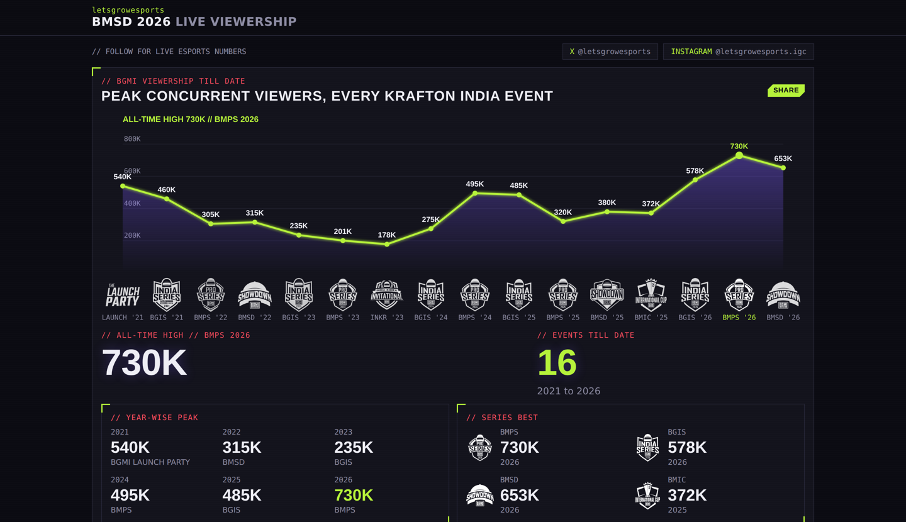
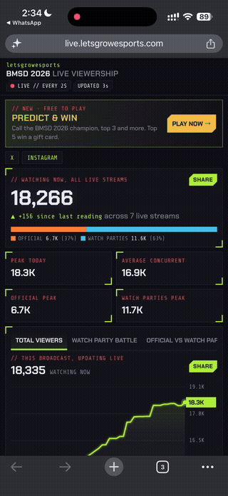

# Live Viewership Tracker

> Picking this up fresh? Read [docs/HANDOFF.md](docs/HANDOFF.md): what runs where, the rules, the code map and the current state. Moving it to another machine or domain: [docs/MOVING.md](docs/MOVING.md).

Runs [live.letsgrowesports.com](https://live.letsgrowesports.com): India's live streaming rankings across YouTube, Kick and Twitch by game and category, and live trackers for esports tournaments. For tournaments it counts every stream carrying an event at once: the official broadcast, the watch parties and community restreams. Produces peak concurrent viewers, average concurrent, hours watched and airtime, split by day, by channel and by stream type.

Built because published tournament viewership arrives days late and often counts the official broadcast alone. In Indian esports that misses a large share of the audience, because much of it watches through creators' watch parties rather than the official stream.

Each event is a short definition: the phrases that identify it, the official broadcaster, and the creator channels allowed to restream it. The same tracker runs for any tournament and any set of YouTube channels.

No API key is required. Viewer counts are read from public YouTube pages through yt-dlp. A YouTube Data API key can be supplied for more exact counts.



<p align="center"></p>

---

## Events tracked

| Event | Dates | Broadcast days | Streams | Peak concurrent | Watch parties at peak | Data |
|---|---|---|---|---|---|---|
| BMSD 2026 (BGMI Showdown) | 10 to 18 Oct 2026 | 7 | 92 | 653,067 | 57% | [`exports/bmsd/`](exports/bmsd/) |

Each event's numbers are exported to `exports/<event>/` when it ends, so every figure in this table can be checked against the raw data.

---

## Case study: BMSD 2026

Battlegrounds Mobile India Showdown 2026, the first event tracked end to end: 7 broadcast days, 92 streams, one reading every 2 seconds.

| | |
|---|---|
| **Peak concurrent** | **653,067**, Sun 18 Oct, 4:55 PM IST |
| Official broadcast at that moment | 282,071 |
| Watch parties at that moment | 370,996 (57%) |


The finals day, minute by minute. The official broadcast and the watch parties rise and fall together with each match, but the watch parties carried more of the audience at all but one of the day's match peaks.


Every figure here is reproducible from `exports/bmsd/`: `daily_peaks.csv` for the bars, `full/viewership_2026-10-18.csv` for the finals day.

---

## What it does

**Finds the streams.** Every 60 seconds it searches YouTube for live streams matching the event's phrases, and checks a list of known channels directly. A stream that drops out of search ranking is re-checked for 15 minutes before being treated as ended, so a ranking change is not recorded as the audience leaving.

**Counts them.** Every 2 seconds each live stream is re-counted. Streams under 50 viewers are re-counted less often, so the budget goes where the audience is.

**Classifies them.** Each stream is labelled official, watch party or community. An allow-list decides which watch-party channels count, which keeps unrelated streams that happen to mention the tournament out of the totals.

**Catches bad readings.** When a stream ends, YouTube's watch page can report total views where a live viewer count used to be. Left alone that lands as a sudden spike. A jump or drop above a size and percentage threshold inside ~15 seconds is held as unconfirmed until the next reading agrees with it, and is recorded as an anomaly either way.

**Serves it.** A dashboard shows the live total, the per-stream breakdown, per-day peaks and, for BGMI events, the event's place in BGMI viewership history. It is served locally and can be exposed through a cloudflared tunnel without a server.

## Metrics

| Metric | How it is derived |
|---|---|
| **Peak concurrent** | Highest combined total across all live streams at one moment, not the sum of each stream's individual peak |
| **Average concurrent** | Mean of the combined totals, measured only while the official broadcast was live |
| **Hours watched** | Concurrent viewers integrated over time |
| **Airtime** | How long each stream was live |
| **Official / watch party / community split** | The same totals attributed by stream type |
| **Anomalies** | Jumps and drops that failed confirmation, kept for audit rather than discarded silently |

Peak concurrent is the combined figure at a single moment, which is the comparable number and is always lower than adding up per-stream peaks, since streams peak at different times.

## Install

```bash
git clone https://github.com/naveen-raj-kanagaraj/viewership-tracker
cd viewership-tracker
python3 -m venv venv && source venv/bin/activate
pip install -r requirements.txt
```

## Use

```bash
python track.py create bmsd      # start tracking an event
python track.py                  # run the tracker and the dashboard
python track.py events           # events and their state
python track.py stats bmsd       # peak, average, per day, per channel
python track.py export bmsd      # CSV and xlsx exports
python track.py pause bmsd       # stop recording, keep serving history
```

The dashboard runs at `http://localhost:8092`.

## Adding an event

Every event is one entry in `PRESETS` in `tracker/events.py`. `bmsd` is there as a full worked example. A new one looks like this:

```python
"bgis26": {
    "name": "BGIS 2026",
    "match":   ["bgis", "battlegrounds india series"],        # a stream's title must contain one of these
    "queries": ["BGIS 2026", "BGIS live", "BGIS watch party"], # what YouTube is searched for
    "official": ["krafton india esports"],                      # channel names counted as official
    "official_channels": ["UCugG6-k5QGbq_iDEPAnG4NQ"],          # channel IDs whose every live stream is tracked
    "always_check": ["@DynamoGaming", "@SoulAman"],             # creator channels checked directly every minute
    "allowed": ["dynamo", "soulaman"],                          # watch-party channels that count toward the total
    "ended": False,                                             # True once it is over: recording stops, history stays
    "next_start": "2026-11-20 13:00",                           # IST; the dashboard counts down to it
    "hist": ["BGIS", "26"],                                     # BGMI events: its point in the history chart
    "roster": True,                                             # show the watch-party roster (ROSTER) and NOT LIVE alert
},
```

Then:

```bash
python track.py create bgis26
python track.py
```

**Tracking channels.** `always_check` is the list of YouTube channels the tracker looks at directly every minute, whether or not they surface in search. Use it for the creators who usually host watch parties. `allowed` decides which of those channels count toward the event's total, so an unrelated stream that mentions the tournament is left out. Leave `allowed` empty to count every matching stream.

## Other games and platforms (Kick, Twitch)

Any game works; YouTube is always on, and Kick and Twitch are added per event. Without editing code:

```bash
python track.py new valo "VCT Pacific" --game Valorant --match "vct,pacific" --queries "VCT Pacific"
python track.py kick valo official valorant        # kick.com/valorant is the official broadcast
python track.py kick valo add tarik                # counted while the stream title matches the event
python track.py twitch valo official valorant
python track.py twitch valo category VALORANT      # top live streams in the category, title must match
python track.py kick valo remove tarik
python track.py platforms                          # which connectors have keys
```

Changes are picked up within a minute by a running tracker. The same fields work in a preset:

```python
"kick":   {"official": ["slug"], "channels": ["slug"], "category": "PUBG Mobile"},
"twitch": {"official": ["login"], "channels": ["login"], "category": "VALORANT"},
"game": "Valorant",
"need_official": False,   # record whenever anything is live, not only while the official broadcast is
"any_title": True,        # count listed Kick/Twitch channels whatever their title says
```

- Twitch uses the official Helix API and needs `TWITCH_CLIENT_ID` and `TWITCH_CLIENT_SECRET` in `.env`.
- Kick uses its official API with `KICK_CLIENT_ID` and `KICK_CLIENT_SECRET`. Without keys it reads the public channel pages
  kick.com itself uses (unofficial: may be rate limited or change); category discovery needs the keys.
- A Kick/Twitch stream is stored as `kick:<slug>` / `twitch:<login>`, one per channel, in the same tables as YouTube
  streams. Counts refresh every `PLATFORM_COUNT_SEC` (15s) in one batched request per platform.
- Every event has its own page at `/e/<key>/`, `/events` lists them, and `/` shows the home event
  (`"home": True` in a preset, or `python track.py home <key>`). The dashboard labels each stream's platform and splits
  the total by platform.

## India rankings (/india)

Alongside events, an always-on scan of Indian live streaming on YouTube, Kick and Twitch, sorted into games and ranked:
live now, the top streamers today / last 7 days / last 30 days by hours watched, peak or average, and games by hours
watched. Every 2 minutes it takes Kick and Twitch streams in the India languages (`SCENE_LANGS`, needs the platform
keys), runs India-localised YouTube live searches for each game (every 5 minutes, every 15 while an event broadcast is
live), re-counts every YouTube stream already found, and checks hand-added channels.

```bash
python track.py scene top 7d
python track.py scene add kick skyesports        # youtube @handle, kick slug or twitch login
python track.py scene block "Some Channel"       # hide from the rankings
python track.py scene probe                      # check each source once
```

It is not a census: streams that never appear in those searches or languages are missed, and the page says so.
Tables: `sc_channels`, `sc_samples` (raw, kept `SCENE_KEEP_DAYS`), `sc_daily` (per IST day, kept).

**When an event ends.** Set `"ended": True`, run `python track.py export <key>`, and add a row to the Events tracked table above. The dashboard keeps serving its history.

## Data

Everything is stored in one SQLite file, `data/tracker.db`, written ahead of time with WAL so the live counter can write while the dashboard reads.

| Table | Holds |
|---|---|
| `ev_streams` | One row per stream found, with its peak and airtime |
| `ev_samples` | Viewer counts per stream, one row per sample |
| `ev_fine` | High-resolution readings behind the live graph |
| `ev_ticks` | Combined totals per moment, with the official / watch party / community split |
| `ev_anomalies` | Flagged jumps and drops, with the reading before and after |

`python track.py export` writes analysis-ready files to `exports/<event>/`: viewership at 2-minute resolution, every stream in long format, and daily peaks, as CSV and xlsx.

## Predict & Win

A prediction game runs on the same dashboard, at `/predict`: viewers pick outcomes, scores resolve when the answers are set, and a leaderboard ranks them. It exists to give the dashboard a reason to be revisited between matches rather than only during them.

Player handles are treated as private. They are written to `exports/private/`, which is gitignored and never pushed. The public export carries questions, answers and the crowd split with no player data.

During BMSD 2026, 1,875 players made 13,824 picks. The results card the game produced:


Set `PREDICT_OPEN=1` to accept entries. With it off, the page shows what the crowd predicted and how it turned out.

## Migrating from the agent

This tracker previously ran inside a larger personal agent. To bring that data across:

```bash
python migrate_from_agent.py ~/path/to/my-agent/data/agent.db --dry-run
python migrate_from_agent.py ~/path/to/my-agent/data/agent.db
```

It copies the event tables, the prediction game and the related key-value rows, and leaves everything else in the agent alone. The source database is opened read-only. Running it twice does not duplicate rows.

## Limits

**YouTube, Kick and Twitch only.** Events also stream on Loco, Rooter and JioCinema in India, and those are not counted. The dashboard names the platforms its totals cover.

**Concurrent viewers are each platform's number.** What is recorded is what YouTube, Kick or Twitch reports, including however each counts a viewer (Twitch and Kick refresh theirs about every 30-60 seconds). The tracker's contribution is combining streams, attributing them and catching bad readings, not auditing the platforms.

**The allow-list is a judgement.** Which watch parties count is a decision, and a different allow-list gives a different total. It is kept explicit in `PRESETS` rather than hidden in a heuristic.

**Discovery depends on search.** A stream that never surfaces in search and is not on a known channel is missed. The known-channel list exists to narrow that gap, not to close it.

**Sampling is every 2 seconds.** A spike shorter than that is not seen.

**The history panel is BGMI-specific.** The dashboard's all-time chart of peak viewers for every KRAFTON India event is a fixed list in `tracker/eventpage.py`, updated by hand. Events outside BGMI use the rest of the dashboard as is.

## Configuration

Copy `.env.example` to `.env`. Every setting is optional.

| Variable | Default | Purpose |
|---|---|---|
| `YOUTUBE_API_KEY` | none | Exact counts from the official API instead of public pages |
| `EVENT_FAST_SEC` | `2` | How often live streams are re-counted |
| `EVENT_POLL_SEC` | `60` | How often YouTube is searched for new streams |
| `EVENT_TZ` | `Asia/Kolkata` | Timezone for day boundaries |
| `EVENT_WEB_PORT` | `8092` | Dashboard port |
| `EVENT_PUBLIC_LINK` | `true` | Public link through cloudflared |
| `PREDICT_OPEN` | `0` | Whether the prediction game accepts entries |
| `TRACKER_DB` | `data/tracker.db` | Database location |

## Layout

```
track.py                 CLI: run, stats, export, event management
tracker/events.py        discovery, counting, classification, anomalies, statistics
tracker/eventpage.py     the dashboard
tracker/web.py           Flask server
tracker/store.py         SQLite
tracker/tunnel.py        public link via cloudflared
tracker/eventlog.py      spreadsheet exports and alerts
tracker/dataexport.py    analysis-ready CSV and xlsx
tracker/visitors.py      dashboard traffic
tracker/predict.py       prediction game
tracker/crowd.py         crowd results once the game closes
migrate_from_agent.py    one-off import from the agent database
```
