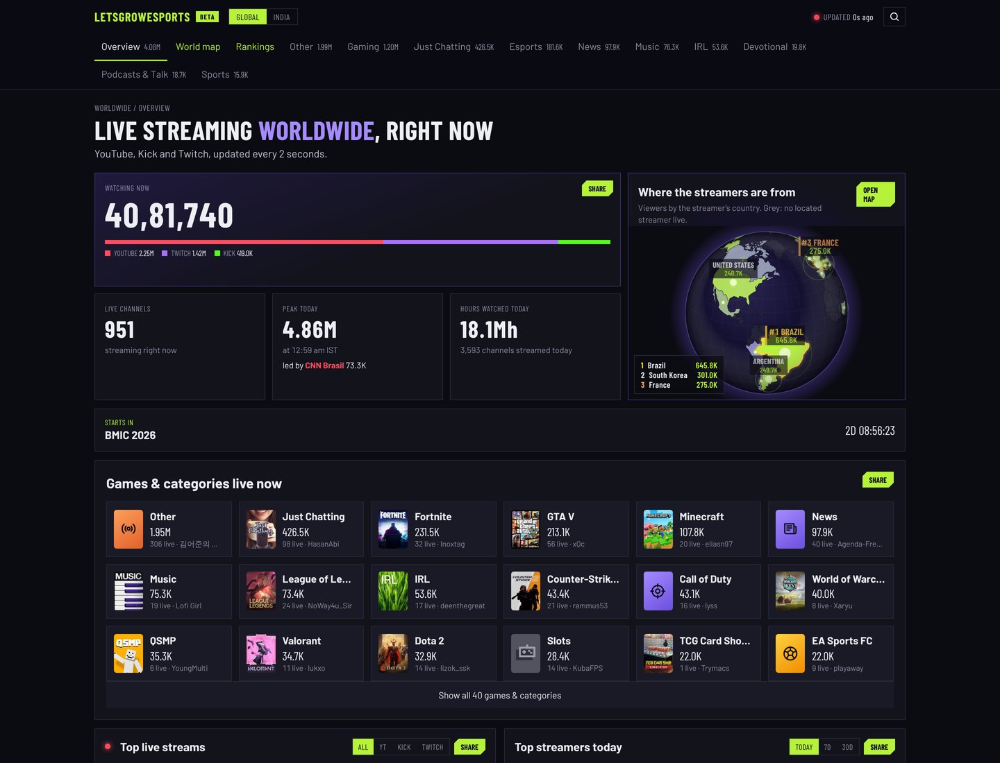
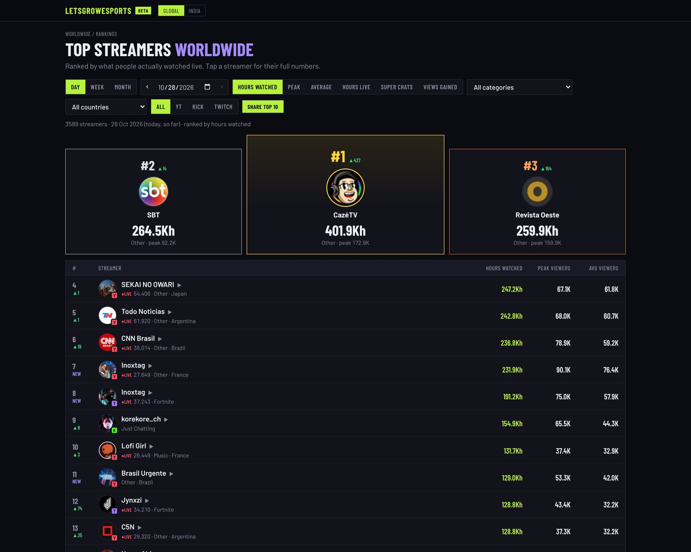
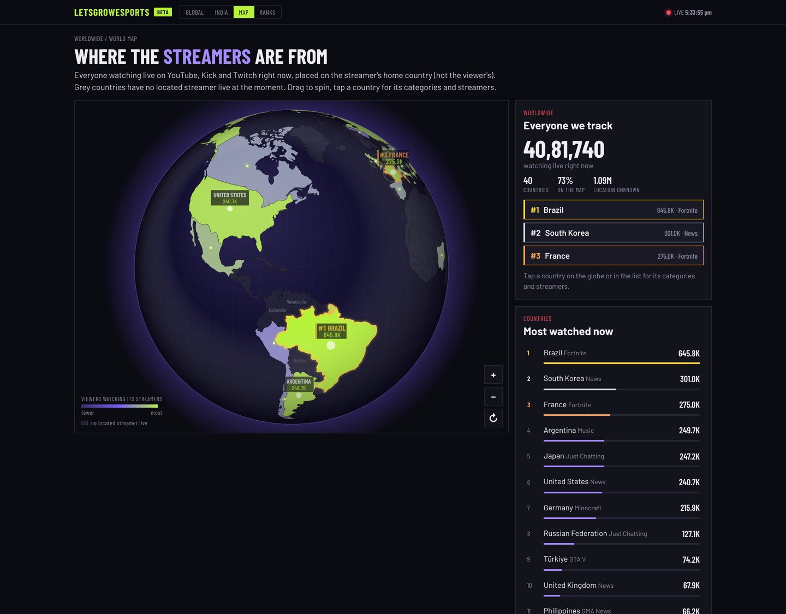
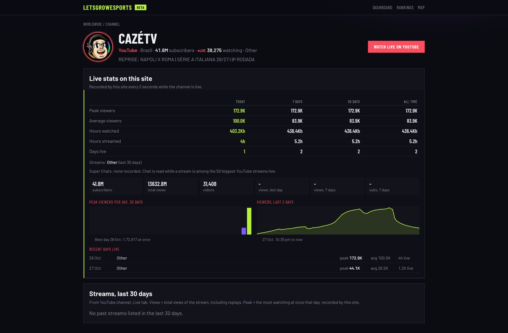
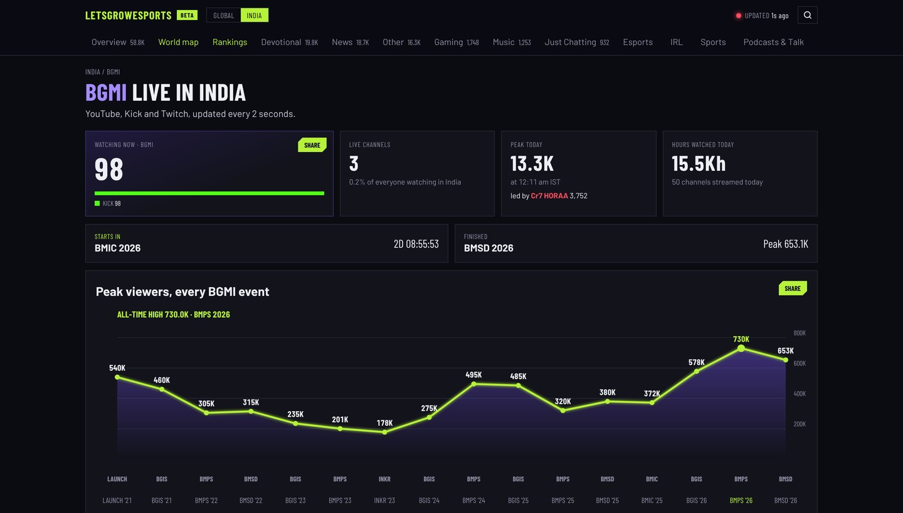

# letsgrowesports Live

**Real-time audience analytics for creators and live streams across YouTube, Twitch and Kick.**
Live at [live.letsgrowesports.com](https://live.letsgrowesports.com) · Built and run by Naveen Raj Kanagaraj

> Maintaining it? Start with [docs/HANDOFF.md](docs/HANDOFF.md). How it works under the hood: [docs/TECHNICAL.md](docs/TECHNICAL.md).



## The problem

Audience numbers for creators and live events are late, partial and split across platforms.

- Event viewership is usually published days later and often counts only the official broadcast.
- YouTube, Twitch and Kick each report in their own way; nobody adds them up per creator, game or country.
- Channel trackers say little about creators outside the US, about live audiences, or about how a channel's recent videos actually perform.

**What the data showed:** at the peak of BMSD 2026, a national esports final, this site measured **653,067 people watching at once, and 57% of them were on creators' watch parties, not the official stream.** An official-only report would have missed most of the audience.

## Who it's for

| User | What they get |
|---|---|
| Creators and streamers | Growth, rank in their category and country, share cards and a live rank badge for their media kit |
| Brands and agencies | Creators ranked by real, current views; side-by-side compare across platforms |
| Tournament organizers | The true live audience of an event, official broadcast plus watch parties, every 2 seconds |
| Fans and media | What the world (or India) is watching right now, top creators today, the moments everyone jumped in |

## What it does

- **Live dashboard:** everyone watching right now across YouTube, Twitch and Kick, by platform, category and game, refreshed every 2 seconds. Worldwide and India views.
- **Channel pages for any channel:** subscribers, lifetime views, views gained per day, every recent video with views, likes, comments and engagement, best day and time to post, and live stats while the channel is streaming.
- **Rankings:** channels by views gained (day, week, month), total views or subscribers; streamers by hours watched, peak or average viewers; filter by YouTube category, game and country.
- **Tournament trackers:** every stream carrying an event (official broadcast and permitted watch parties) counted together, with the official vs watch-party split.
- **Moments:** sudden audience jumps detected from chat speed and viewer counts, linked to that second of the stream.
- **Compare, search, share cards, creator badges, world map.**

| Rankings | World map |
|---|---|
|  |  |
| **Channel page** | **Game page (BGMI)** |
|  |  |

## My role

I own the product end to end: problem definition, users, requirements, metric definitions, prioritization, release decisions and operations. I built it with an AI coding agent (Claude): I wrote the specs and acceptance criteria, reviewed every release, set the guardrails (tests before every merge, no secrets in code, owner-only data stays private) and tested each version on the live site.

| Product work | Artifact |
|---|---|
| Product requirements: problem, users and jobs to be done, goals and non-goals, prioritized requirements, risks | [PRD](docs/product/PRD.md) |
| One definition for every number on the site, north star and health metrics | [Metric definitions](docs/product/METRICS.md) |
| The calls that shaped the product and the trade-off behind each | [Decision log](docs/product/DECISIONS.md) |
| What comes next and how success is judged | [Roadmap](docs/product/ROADMAP.md) |
| Event analysis: BMSD 2026 audience, official vs watch parties | [Case study](#case-study-bmsd-2026) |
| Platform compliance: privacy policy, terms, YouTube API attribution, API quota extension request | [Privacy](https://live.letsgrowesports.com/privacy) · [Terms](https://live.letsgrowesports.com/terms) |

**Execution:** 55 releases merged in 11 days (19 to 29 Oct 2026), each with automated tests; about 13,000 lines of Python.

**Problems worked through along the way**
- **Trust:** wrong readings (a channel's lifetime views below its own biggest video, a misread "10.56K" as 1,056) are now rejected automatically instead of shown.
- **Platform limits:** a background job was using up the daily YouTube API allowance; I added a usage meter with priorities, cut the cost per channel, and filed a quota extension so the site can follow 100,000+ channels.
- **Coverage:** Twitch totals looked low next to other trackers because only the top streams were counted; the worldwide view now counts every live Twitch stream.
- **Signal over noise:** moments now need a real audience jump (8% and 1,000 viewers) and skip news streams, after small 3% jumps were flagged as moments.
- **Product health:** an owner-only page shows visitors, API use and any data source that failed, so problems are caught by the product, not by users.

## Case study: BMSD 2026

Battlegrounds Mobile India Showdown 2026, tracked end to end: 7 broadcast days, 92 streams, one reading every 2 seconds.

| | |
|---|---|
| **Peak concurrent** | **653,067**, Sun 18 Oct, 4:55 PM IST |
| Official broadcast at that moment | 282,071 |
| Watch parties at that moment | 370,996 (57%) |


The official broadcast and the watch parties rise and fall together with each match, but watch parties carried more of the audience at all but one of the finals' match peaks. Every figure is reproducible from `exports/bmsd/`.

## How it works

- **Sources:** YouTube Data API (channel and video statistics, read-only), YouTube's public live pages, Twitch and Kick official APIs.
- **Freshness:** live counts every 2 seconds; channel statistics daily plus hourly readings for the most active channels.
- **Accuracy:** sanity checks on every reading, labelled estimates, metered API use.
- **Stack:** Python and Flask, SQLite, Cloudflare in front of a single cloud VM, stdlib-first so updates deploy without new dependencies.
- **Privacy:** no accounts, no tracking cookies, no IP addresses stored.

Details, commands and configuration: [docs/TECHNICAL.md](docs/TECHNICAL.md).

## Run it

```bash
pip install -r requirements.txt
cp .env.example .env      # every setting is optional
python track.py           # tracker + website at http://localhost:8092
```

Keys go in `.env` (never in git). Setup, hosting and every option: [docs/TECHNICAL.md](docs/TECHNICAL.md).

---

Unofficial. Not affiliated with YouTube, Google, Twitch, Kick or any game publisher. Uses YouTube API Services: [YouTube Terms of Service](https://www.youtube.com/t/terms), [Google Privacy Policy](https://policies.google.com/privacy).
