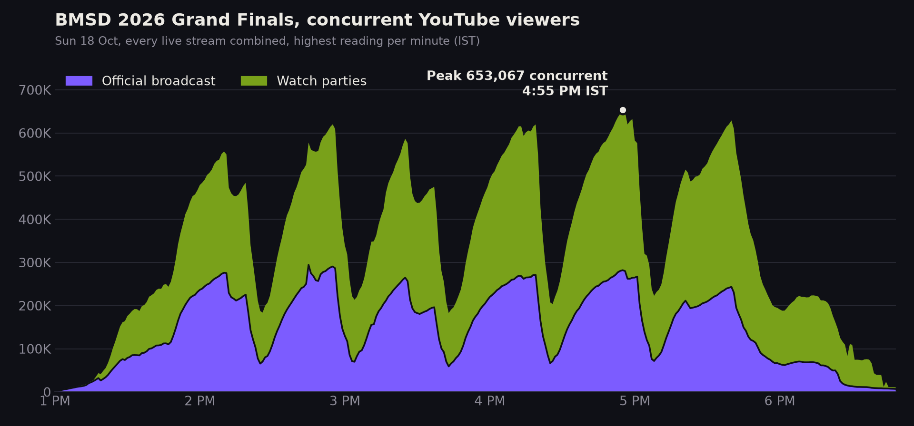
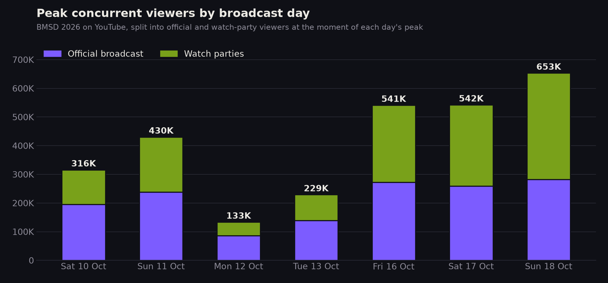
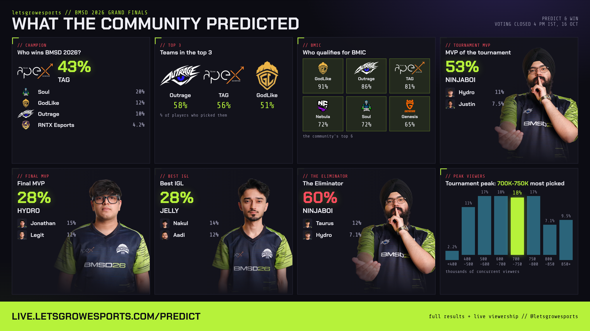

# Technical reference

How the tracker works, how to run it and how to configure it. The product overview is in the [README](../README.md); the handover notes for whoever maintains it are in [HANDOFF.md](HANDOFF.md).

## Live streaming rankings

### What is tracked

Every 2 minutes, a scan of what is live:

| Source | What |
|---|---|
| Twitch | The top 500 live streams worldwide, plus official esports channels, plus streams in the India languages (`SCENE_LANGS`) |
| Kick | The top live streams, plus the India languages and main Indian categories |
| YouTube | YouTube's own Live page for India, the US and 20 more countries (`SCENE_YT_COUNTRIES`), plus live searches for every big game, esport and category |
| Hand-added channels | `python track.py scene add youtube @handle` (or a Kick slug / Twitch login) |

Viewer counts are then refreshed every 2 seconds for every Kick and Twitch stream and the biggest YouTube streams, and every scan for the rest.

**Indian or not.** A YouTube channel's own country setting decides. Otherwise the stream's language tag (Kick, Twitch), an Indian script, or Indian words in the title. Channels can be allowed or blocked by hand.

**Categories.** From the platform's category (Kick, Twitch) or the stream title (YouTube): BGMI, Free Fire, PUBG Mobile, Valorant, GTA V, Call of Duty, Cricket, News, Devotional, Music and so on, grouped into sections. Esports streams are detected from tournament names in the title (VCT, BGIS, PMGC, CEGC ...) and grouped with their co-streams.

### Metrics

| Metric | How it is derived |
|---|---|
| **Watching now** | Sum of every tracked live stream's current viewers (each platform's own count) |
| **Peak** | Highest "watching now" at one moment (per day IST, per stream, per channel) |
| **Hours watched** | Viewers integrated over time live |
| **Average viewers** | Hours watched / hours live |
| **Hours live** | Time a channel was live |
| **Super Chats** | Super Chats and Super Stickers paid on the 50 biggest YouTube live streams, converted at the day's exchange rate, before YouTube's cut |
| **Views gained** | Growth of a YouTube channel's total views (all videos) between daily snapshots |

**Super Chats.** The live chat of the top 50 YouTube streams (`SUPERCHAT_TOP`) is read every 5 to 15 seconds, the way the YouTube player reads it. Each paid message, sticker, membership and gift is stored once. Smaller streams are not read; Kick and Twitch have no equivalent.

**Channel stats.** Once a day, every YouTube channel the site has seen live gets a snapshot of subscribers, total views and video count (`CHANNEL_STATS_MAX` per day, most watched first). With `YOUTUBE_API_KEY` this uses the YouTube Data API; without it, channel About pages.

**Past streams.** A channel page lists its streams in the last 30 days from the platform itself: the YouTube channel's Live tab, or Twitch's past broadcasts. Kick has no public list.

**Where the streamers are from (the globe).** A viewer is placed on the streamer's country: the YouTube channel's country, India for streams detected as Indian, and for Kick and Twitch the stream language where it points to one country (Portuguese = Brazil, Korean, Japanese, Turkish ...). English and Spanish Kick/Twitch streams can't be placed and are left off; the page says how many.

### Commands

```bash
python track.py scene top 7d                     # top streamers in the terminal
python track.py scene probe                      # check each source once
python track.py scene add kick skyesports        # youtube @handle, kick slug or twitch login
python track.py scene block "Some Channel"       # hide from the rankings
python track.py scene allow "Some Channel"       # count as Indian
python track.py scene superchat <video id> 60    # read one stream's chat for 60s and list what was paid
python track.py scene stats @handle              # one channel's subscribers, total views, videos
```

---

## Tournament trackers

Each event is a short definition: the phrases that identify it, the official broadcaster, and the creator channels allowed to restream it. The same tracker runs for any tournament and any set of channels.

### Events tracked

| Event | Dates | Broadcast days | Streams | Peak concurrent | Watch parties at peak | Data |
|---|---|---|---|---|---|---|
| BMSD 2026 (BGMI Showdown) | 10 to 18 Oct 2026 | 7 | 92 | 653,067 | 57% | [`exports/bmsd/`](../exports/bmsd/) |

Each event's numbers are exported to `exports/<event>/` when it ends, so every figure in this table can be checked against the raw data.

---

### Case study: BMSD 2026

Battlegrounds Mobile India Showdown 2026, the first event tracked end to end: 7 broadcast days, 92 streams, one reading every 2 seconds.

| | |
|---|---|
| **Peak concurrent** | **653,067**, Sun 18 Oct, 4:55 PM IST |
| Official broadcast at that moment | 282,071 |
| Watch parties at that moment | 370,996 (57%) |



The finals day, minute by minute. The official broadcast and the watch parties rise and fall together with each match, but the watch parties carried more of the audience at all but one of the day's match peaks.



Every figure here is reproducible from `exports/bmsd/`: `daily_peaks.csv` for the bars, `full/viewership_2026-10-18.csv` for the finals day.

### How a tournament is tracked

**Finds the streams.** Every 60 seconds it searches YouTube for live streams matching the event's phrases, and checks a list of known channels directly. A stream that drops out of search ranking is re-checked for 15 minutes before being treated as ended, so a ranking change is not recorded as the audience leaving.

**Counts them.** Every 2 seconds each live stream is re-counted. Streams under 50 viewers are re-counted less often, so the budget goes where the audience is.

**Classifies them.** Each stream is labelled official, watch party or community. An allow-list decides which watch-party channels count, which keeps unrelated streams that happen to mention the tournament out of the totals.

**Catches bad readings.** When a stream ends, YouTube's watch page can report total views where a live viewer count used to be. Left alone that lands as a sudden spike. A jump or drop above a size and percentage threshold inside ~15 seconds is held as unconfirmed until the next reading agrees with it, and is recorded as an anomaly either way.

**Serves it.** A dashboard shows the live total, the per-stream breakdown, per-day peaks and, for BGMI events, the event's place in BGMI viewership history. It is served locally and can be exposed through a cloudflared tunnel without a server.

### Tournament metrics

| Metric | How it is derived |
|---|---|
| **Peak concurrent** | Highest combined total across all live streams at one moment, not the sum of each stream's individual peak |
| **Average concurrent** | Mean of the combined totals, measured only while the official broadcast was live |
| **Hours watched** | Concurrent viewers integrated over time |
| **Airtime** | How long each stream was live |
| **Official / watch party / community split** | The same totals attributed by stream type |
| **Anomalies** | Jumps and drops that failed confirmation, kept for audit rather than discarded silently |

Peak concurrent is the combined figure at a single moment, which is the comparable number and is always lower than adding up per-stream peaks, since streams peak at different times.

### Commands

```bash
python track.py create bmsd      # start tracking an event
python track.py events           # events and their state
python track.py stats bmsd       # peak, average, per day, per channel
python track.py export bmsd      # CSV and xlsx exports
python track.py pause bmsd       # stop recording, keep serving history
python track.py home bmic        # show this event at / (python track.py home hub to undo)
```

### Adding an event

Every event is one entry in `PRESETS` in `tracker/events.py`. `bmsd` is there as a full worked example. A new one looks like this:

```python
"bgis26": {
    "name": "BGIS 2026",
    "match":   ["bgis", "battlegrounds india series"],        # a stream's title must contain one of these
    "queries": ["BGIS 2026", "BGIS live", "BGIS watch party"], # what YouTube is searched for
    "official": ["krafton india esports"],                      # channel names counted as official
    "official_channels": ["UCugG6-k5QGbq_iDEPAnG4NQ"],          # channel IDs whose every live stream is tracked
    "always_check": ["@DynamoGaming", "@SoulAman"],             # creator channels checked directly every minute
    "allowed": ["dynamo", "soulaman"],                          # watch-party channels that count toward the total
    "ended": False,                                             # True once it is over: recording stops, history stays
    "next_start": "2026-11-20 13:00",                           # IST; the dashboard counts down to it
    "hist": ["BGIS", "26"],                                     # BGMI events: its point in the history chart
    "roster": True,                                             # show the watch-party roster (ROSTER) and NOT LIVE alert
},
```

Then:

```bash
python track.py create bgis26
python track.py
```

**Tracking channels.** `always_check` is the list of YouTube channels the tracker looks at directly every minute, whether or not they surface in search. Use it for the creators who usually host watch parties. `allowed` decides which of those channels count toward the event's total, so an unrelated stream that mentions the tournament is left out. Leave `allowed` empty to count every matching stream.

### Other games and platforms (Kick, Twitch)

Any game works; YouTube is always on, and Kick and Twitch are added per event. Without editing code:

```bash
python track.py new valo "VCT Pacific" --game Valorant --match "vct,pacific" --queries "VCT Pacific"
python track.py kick valo official valorant        # kick.com/valorant is the official broadcast
python track.py kick valo add tarik                # counted while the stream title matches the event
python track.py twitch valo official valorant
python track.py twitch valo category VALORANT      # top live streams in the category, title must match
python track.py kick valo remove tarik
python track.py platforms                          # which connectors have keys
```

Changes are picked up within a minute by a running tracker. The same fields work in a preset:

```python
"kick":   {"official": ["slug"], "channels": ["slug"], "category": "PUBG Mobile"},
"twitch": {"official": ["login"], "channels": ["login"], "category": "VALORANT"},
"game": "Valorant",
"need_official": False,   # record whenever anything is live, not only while the official broadcast is
"any_title": True,        # count listed Kick/Twitch channels whatever their title says
```

- Twitch uses the official Helix API and needs `TWITCH_CLIENT_ID` and `TWITCH_CLIENT_SECRET` in `.env`.
- Kick uses its official API with `KICK_CLIENT_ID` and `KICK_CLIENT_SECRET`. Without keys it reads the public channel pages
  kick.com itself uses (unofficial: may be rate limited or change); category discovery needs the keys.
- A Kick/Twitch stream is stored as `kick:<slug>` / `twitch:<login>`, one per channel, in the same tables as YouTube
  streams. Counts refresh every `PLATFORM_COUNT_SEC` (15s) in one batched request per platform.
- Every event has its own page at `/e/<key>/`, `/events` lists them, and `/` shows the home event
  (`"home": True` in a preset, or `python track.py home <key>`). The dashboard labels each stream's platform and splits
  the total by platform.

**When an event ends.** Set `"ended": True`, run `python track.py export <key>`, and add a row to the Events tracked table. Its page keeps serving the history.

### Predict & Win

A prediction game runs on the same dashboard, at `/predict`: viewers pick outcomes, scores resolve when the answers are set, and a leaderboard ranks them. It exists to give the dashboard a reason to be revisited between matches rather than only during them.

Player handles are treated as private. They are written to `exports/private/`, which is gitignored and never pushed. The public export carries questions, answers and the crowd split with no player data.

During BMSD 2026, 1,875 players made 13,824 picks. The results card the game produced:



Set `PREDICT_OPEN=1` to accept entries. With it off, the page shows what the crowd predicted and how it turned out.

---

## Install and run

```bash
git clone https://github.com/naveen-raj-kanagaraj/viewership-tracker
cd viewership-tracker
python3 -m venv venv && source venv/bin/activate
pip install -r requirements.txt
cp .env.example .env             # every setting is optional
python track.py                  # tracker + website at http://localhost:8092
```

## Hosting

It runs as one Python process with one SQLite file, so any always-on Linux machine works. Production runs on an Oracle Cloud Always Free ARM VM (Ubuntu 24.04) as a systemd service, published through a Cloudflare tunnel.

```bash
bash scripts/deploy_oracle.sh <server ip> <ssh key>   # first install on a fresh server
bash scripts/oracle.sh status                         # is it running, last log lines
bash scripts/oracle.sh logs                           # follow the log
bash scripts/oracle.sh restart
bash scripts/oracle.sh backup                         # copy a database backup to this machine
bash scripts/oracle.sh run scene probe                # any track.py command on the server
```

The server's address and key path live in a local `.server` file, which is gitignored.

**Updates deploy themselves.** Every 10 minutes the tracker fetches `main`, fast-forwards, checks that every file compiles (rolling back if not) and restarts in place. It skips this while a tournament broadcast is live. Turn off with `AUTO_UPDATE=false`.

**Backups.** A copy of the database is made every night (about 03:00 IST); the newest 3 are kept in `backups/`.

## Data

Everything is in one SQLite file, `data/tracker.db` (WAL mode, so counting and serving run at once). It holds private Predict & Win player data and is never committed.

| Table | Holds |
|---|---|
| `sc_channels` | Every channel seen live: platform, name, logo, country, Indian or not, last title and game |
| `sc_samples` | Each live channel's viewers every scan (kept `SCENE_KEEP_DAYS`) |
| `sc_daily` | Per channel, game and IST day: peak, minutes live, hours watched (kept for good) |
| `sc_cat`, `sc_reg` | Totals per scan for India, worldwide, each section and each tournament |
| `sc_superchat` | Every Super Chat, sticker, membership and gift read, with amount, currency, USD and INR |
| `sc_chstats` | Daily YouTube channel snapshots: subscribers, total views, videos |
| `ev_streams`, `ev_samples`, `ev_fine`, `ev_ticks`, `ev_anomalies` | Tournament trackers: streams, readings, combined totals by stream type, flagged readings |

`python track.py export <event>` writes analysis-ready CSV and xlsx to `exports/<event>/`. Private player data only ever goes to `exports/private/` and `backups/`, both gitignored.

## API

All JSON, read-only, cached for a few seconds:

| Endpoint | Returns |
|---|---|
| `/api/scene/live?region=global\|in&sec=&cat=` | What moves every 2 seconds: totals, platforms, sections, games, live streams |
| `/api/scene?region=&sec=&cat=&period=today\|7d\|30d` | Everything on a dashboard page, including top streamers and day-by-day totals |
| `/api/rank?region=&metric=hw\|peak\|avg\|hours\|sc\|vg&period=day\|week\|month&date=&cat=&country=&platform=` | Rankings |
| `/api/channel?sid=` | One channel's analytics |
| `/api/past?sid=` | A channel's streams in the last 30 days, from the platform |
| `/api/search?q=&region=` | Channels and stream titles matching `q`, and matching categories |
| `/api/geo` | Live viewers by streamer country |

## Limits

**YouTube, Kick and Twitch only.** Loco, Rooter and JioCinema are not counted.

**Not a census.** YouTube has no complete list of live streams, so YouTube totals are a floor: a stream that never shows up on the Live pages, in searches or on a hand-added channel is missed.

**Concurrent viewers are each platform's number,** including however each counts a viewer. The tracker combines, attributes and checks them; it doesn't audit them.

**Peaks before tracking started can't be recovered.** YouTube doesn't keep concurrent viewers after a stream ends; past streams show total views instead.

**Total views of live streams aren't ranked.** Kick and Twitch don't publish them, and YouTube's include replays.

**Super Chats cover the top 50 YouTube streams.** Amounts are what viewers paid, before YouTube's cut, at that day's exchange rate.

**Country placement is partial** for Kick and Twitch, which publish no streamer country.

**The tournament allow-list is a judgement.** Which watch parties count is a decision, kept explicit in `PRESETS` rather than hidden in a heuristic.

**Sampling is every 2 seconds.** A spike shorter than that is not seen.

## Configuration

Copy `.env.example` to `.env`. Every setting is optional.

| Variable | Default | Purpose |
|---|---|---|
| `YOUTUBE_API_KEY` | none | Exact channel countries and channel stats from the YouTube Data API |
| `TWITCH_CLIENT_ID`, `TWITCH_CLIENT_SECRET` | none | Twitch (dev.twitch.tv app) |
| `KICK_CLIENT_ID`, `KICK_CLIENT_SECRET` | none | Kick (kick.com developer app) |
| `SCENE_ENABLED` | `true` | The live rankings scan |
| `SCENE_SEC` | `120` | How often new streams are looked for |
| `SCENE_YT_SEC` | `300` | How often YouTube Live pages and searches run |
| `SCENE_YT_COUNTRIES` | 20 countries | Extra YouTube Live page editions read |
| `SCENE_LANGS` | `hi` | Kick/Twitch languages counted as Indian |
| `SCENE_MIN_VIEWERS` / `SCENE_GLOBAL_MIN` | `20` / `100` | Smallest Indian / other stream kept |
| `SCENE_KEEP_DAYS` | `3` | Days of raw per-scan readings kept |
| `SUPERCHAT`, `SUPERCHAT_TOP` | `true`, `50` | Super Chat reading, and on how many YouTube streams |
| `CHANNEL_STATS`, `CHANNEL_STATS_MAX` | `true`, `3000` | Daily YouTube channel snapshots, and how many per day |
| `EVENT_FAST_SEC` / `EVENT_POLL_SEC` | `2` / `60` | Tournament re-count and search intervals |
| `EVENT_TZ` | `Asia/Kolkata` | Day boundaries |
| `EVENT_WEB_PORT` | `8092` | Website port |
| `EVENT_PUBLIC_LINK`, `EVENT_TUNNEL_NAME`, `EVENT_PUBLIC_URL` | | Cloudflare tunnel and public address |
| `AUTO_UPDATE`, `AUTO_UPDATE_MIN` | `true`, `10` | Self-update from GitHub |
| `BACKUP_NIGHTLY`, `BACKUP_KEEP` | `true`, `3` | Nightly database backups |
| `PREDICT_OPEN` | `0` | Whether Predict & Win accepts entries |
| `TRACKER_DB` | `data/tracker.db` | Database location |

## Layout

```
track.py                  CLI: run, scene, events, stats, export, backup
tracker/scene.py          live rankings: scan, classification, countries, rankings, channel analytics
tracker/ytextra.py        Super Chats, daily YouTube channel stats, past streams
tracker/platforms.py      Kick and Twitch APIs, count parsing
tracker/scenepage.py      dashboard pages (/, /india, sections, games) and the shared channel panel
tracker/rankpage.py       rankings page
tracker/chpage.py         channel pages
tracker/mappage.py        the 3D globe
tracker/events.py         tournament trackers: discovery, counting, classification, anomalies, statistics
tracker/eventpage.py      tournament pages
tracker/web.py            Flask server, routes, response cache
tracker/store.py          SQLite
tracker/autoupdate.py     self-update from GitHub
tracker/backup.py         nightly backups
tracker/tunnel.py         Cloudflare tunnel
tracker/predict.py        Predict & Win (and predictpage.py, crowd.py, crowdpage.py)
tracker/eventlog.py       spreadsheet exports and alerts
tracker/dataexport.py     analysis-ready CSV and xlsx
tracker/visitors.py       site traffic
scripts/deploy_oracle.sh  first install on a server
scripts/oracle.sh         manage the server from your computer
tests/                    test_scene.py, test_plat.py (mocked platforms, temporary database)
migrate_from_agent.py     one-off import from the old agent database
```

### Migrating from the agent

This tracker previously ran inside a larger personal agent. To bring that data across:

```bash
python migrate_from_agent.py ~/path/to/my-agent/data/agent.db --dry-run
python migrate_from_agent.py ~/path/to/my-agent/data/agent.db
```

It copies the event tables, the prediction game and the related key-value rows, and leaves everything else in the agent alone. The source database is opened read-only. Running it twice does not duplicate rows.

